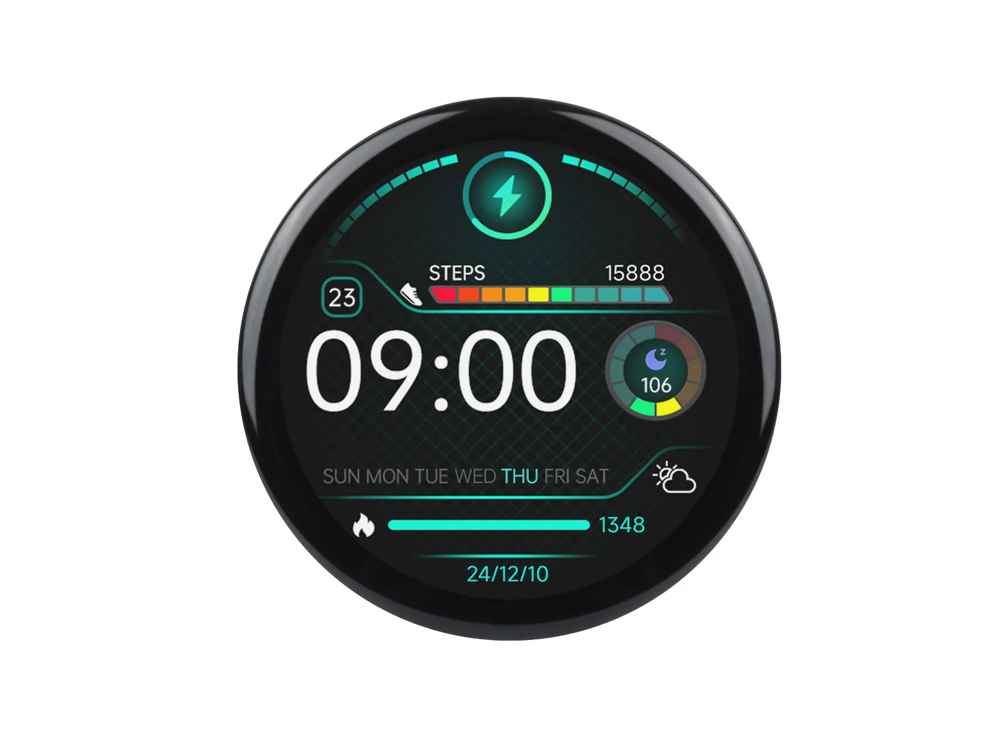

  <h1>ESP32-S3-Touch-LCD-1.46</h1>
  
<strong>ESP32-S3 development board with a 1.46-inch touch LCD</strong>

  
<strong>English</strong> | <a href="README_ZH.md">简体中文</a>

  
  

  

    <a href="https://docs.waveshare.com/ESP32-S3-Touch-LCD-1.46">🛒 Product</a> &middot;
    <a href="firmware/">📦 Firmware</a> &middot;
    <a href="examples/factory/">🧩 ESP-IDF</a> &middot;
    <a href="https://docs.waveshare.com/ESP32-S3-Touch-LCD-1.46">📖 Documentation</a>
  

  

---

## ✨ Overview

ESP32-S3-Touch-LCD-1.46 combines an ESP32-S3R8 controller with a round touch LCD and onboard motion, audio, RTC, microphone, and TF card peripherals. This repository includes the open factory demonstration project and a tested merged factory image.

| Feature | Device / interface |
| --- | --- |
| MCU | ESP32-S3R8 |
| Memory | 16 MB Flash, 8 MB PSRAM |
| Display | 1.46-inch, 412 × 412, SPD2010 |
| Touch | SPD2010 over I2C |

## 📦 Quick Start

Download [`ESP32-S3-Touch-LCD-1.46_FactoryOnly_20261119.bin`](firmware/ESP32-S3-Touch-LCD-1.46_FactoryOnly_20261119.bin) and flash it from `0x0` after erasing the device.

## 🧪 Examples

| Example | Main feature |
| --- | --- |
| [Factory firmware](examples/factory/) | Out-of-box display, touch, audio, sensor, RTC, and storage demonstration |
| [Arduino LVGL](examples/arduino/examples/LVGL_Arduino/) | LVGL display and peripheral demonstration |

## 🛠️ Development Environment

| Framework | Version | Projects |
| --- | --- | ---: |
| ESP-IDF factory firmware | v5.4.x | 1 |
| Arduino-ESP32 | 3.3.11 | 1 |

## 📚 Resources

- [Product documentation](https://docs.waveshare.com/ESP32-S3-Touch-LCD-1.46)
- [Firmware](firmware/)

## 🤝 Support

- [Open an issue](https://github.com/waveshareteam/ESP32-S3-Touch-LCD-1.46/issues)
- [Waveshare support](https://service.waveshare.com/)

## 📄 License

License information is provided by the source components.

