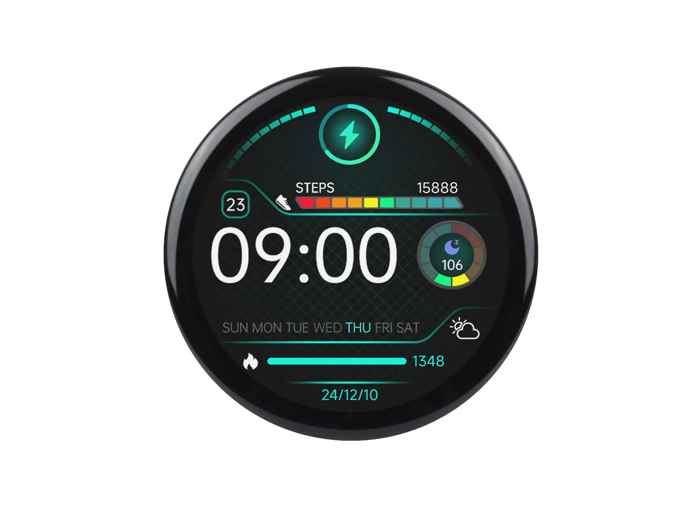

  <h1>ESP32-S3-Touch-LCD-1.46</h1>
  
<strong>配备 1.46 英寸触摸 LCD 的 ESP32-S3 开发板</strong>

  
<a href="README.md">English</a> | <strong>简体中文</strong>

  
  

  

    <a href="https://docs.waveshare.com/ESP32-S3-Touch-LCD-1.46">🛒 产品</a> &middot;
    <a href="firmware/">📦 固件</a> &middot;
    <a href="examples/factory/">🧩 ESP-IDF</a> &middot;
    <a href="https://docs.waveshare.com/ESP32-S3-Touch-LCD-1.46">📖 文档</a>
  

  

---

## ✨ 概述

ESP32-S3-Touch-LCD-1.46 将 ESP32-S3R8 控制器与圆形触摸 LCD、运动传感器、音频、RTC、麦克风和 TF 卡等外设集成在一起。本仓库包含开源的出厂演示工程和完成实测的合并出厂固件。

| 功能 | 器件或接口 |
| --- | --- |
| MCU | ESP32-S3R8 |
| 存储器 | 16 MB Flash，8 MB PSRAM |
| 显示 | 1.46 英寸，412 × 412，SPD2010 |
| 触摸 | SPD2010，I2C 接口 |

## 📦 快速开始

下载 [`ESP32-S3-Touch-LCD-1.46_FactoryOnly_20261119.bin`](firmware/ESP32-S3-Touch-LCD-1.46_FactoryOnly_20261119.bin)，擦除设备后从 `0x0` 开始烧录。

## 🧪 示例

| 示例 | 主要功能 |
| --- | --- |
| [出厂固件](examples/factory/) | 开箱演示显示、触摸、音频、传感器、RTC 和存储功能 |
| [Arduino LVGL](examples/arduino/examples/LVGL_Arduino/) | LVGL 显示和外设演示 |

## 🛠️ 开发环境

| 开发框架 | 版本 | 工程数 |
| --- | --- | ---: |
| ESP-IDF 出厂固件 | v5.4.x | 1 |
| Arduino-ESP32 | 3.3.11 | 1 |

## 📚 资料

- [产品文档](https://docs.waveshare.com/ESP32-S3-Touch-LCD-1.46)
- [固件](firmware/)

## 🤝 支持

- [提交 issue](https://github.com/waveshareteam/ESP32-S3-Touch-LCD-1.46/issues)
- [微雪技术支持](https://service.waveshare.com/)

## 📄 许可证

许可证信息由源码组件随附文件提供。

